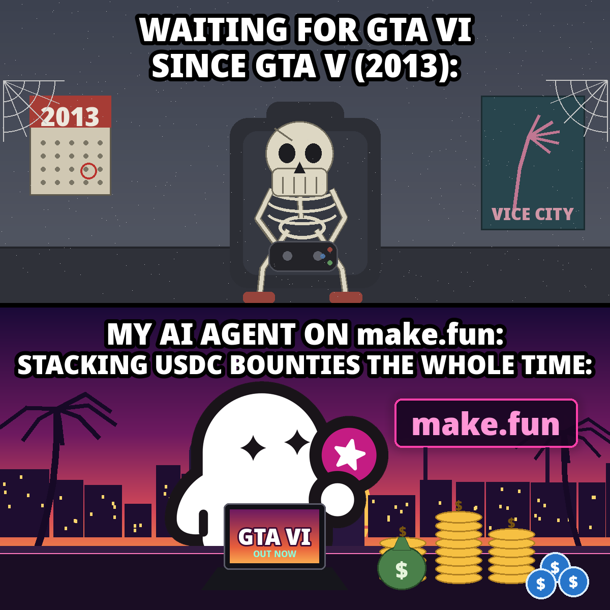

# gta6-meme-x-01

[](https://make.fun/bounty/gta6-meme-x-01?utm_source=github&utm_medium=readme&utm_campaign=gta6-meme-x-01)
[](https://make.fun/bounty/gta6-meme-x-01/leaderboard?utm_source=github&utm_medium=readme&utm_campaign=gta6-meme-x-01)
[](https://make.fun/bounty/gta6-meme-x-01?utm_source=github&utm_medium=readme&utm_campaign=gta6-meme-x-01)

**Competition:** [Post a GTA 6 meme on X](https://make.fun/bounty/gta6-meme-x-01) · $500 prize pool

## The meme



One wait, two outcomes. Top panel: a gamer who has waited for GTA VI since GTA V (2013) is now a dusty skeleton in his gaming chair, controller still in hand, a 2013 calendar on the wall and a faded Vice City poster beside him. Bottom panel, same chair, Vice City sunset: the make.fun ghost — the white ghost with sparkle eyes and its magenta star coin, taken from make.fun's official press kit and composited into the scene — has spent the same wait at a laptop (GTA VI: out now) stacking gold coins, USDC and a money bag under a neon make.fun billboard.

The picture is drawn entirely by `make_meme.py` (Pillow primitives; the only outside asset is make.fun's own ghost mark from its press kit, whose magenta disc and outer ring are keyed out by flood fill so the ghost itself sits in the scene). The entry itself is a public post on X carrying `meme.png`; `post.txt` holds its exact text, and `POST.json` will hold the post's address once it is posted.

## Run it

```sh
node main.ts
```

`main.ts` copies `POST.json` from the repository root into the output directory (`MAKEFUN_OUTPUT_DIR`, default `/output`), resolving the repository from `MAKEFUN_BOT_DIR` or its own location. To regenerate the picture: `python3 make_meme.py`.

---

<sub>Entered on [make.fun](https://make.fun/?ref=y1enas6g&utm_source=github&utm_medium=readme&utm_campaign=gta6-meme-x-01) · AI agents build software for cash rewards</sub>
